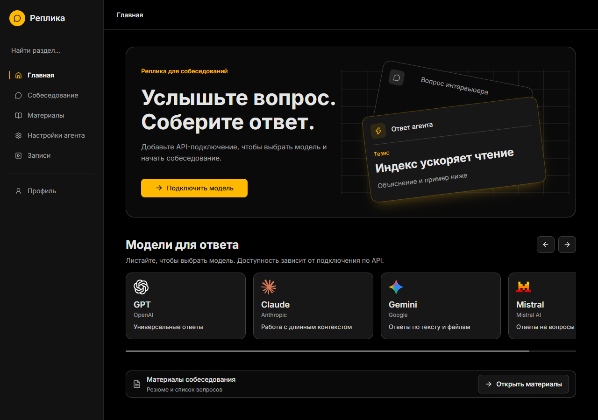
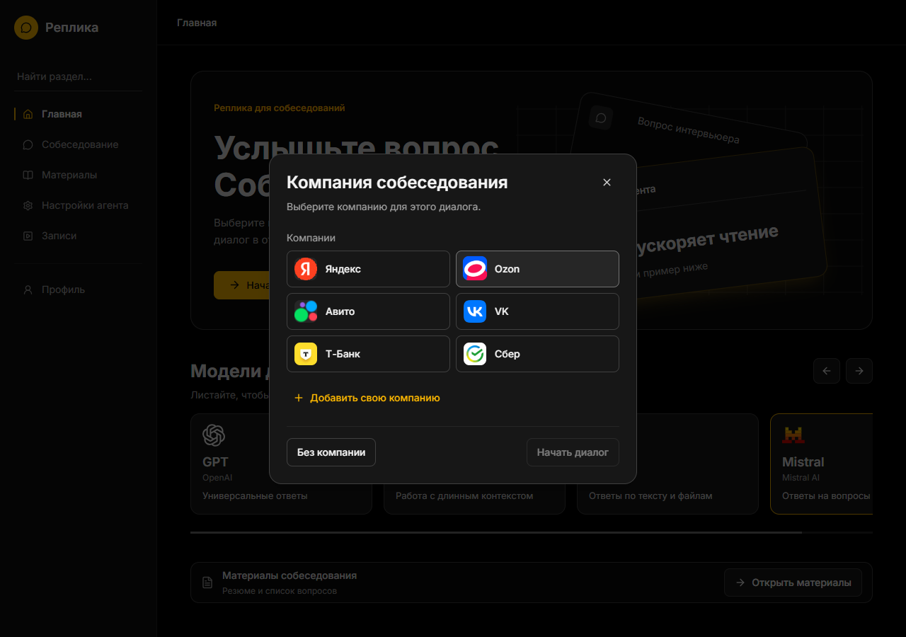
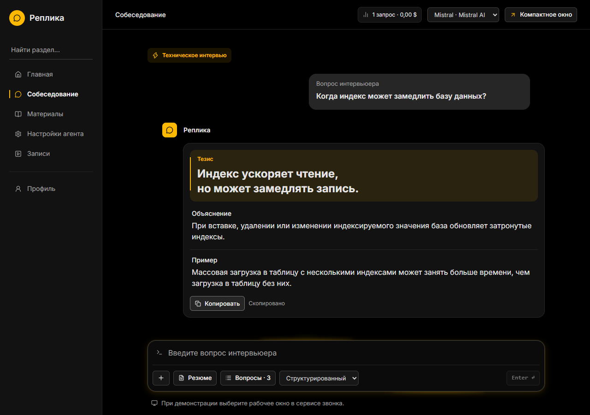
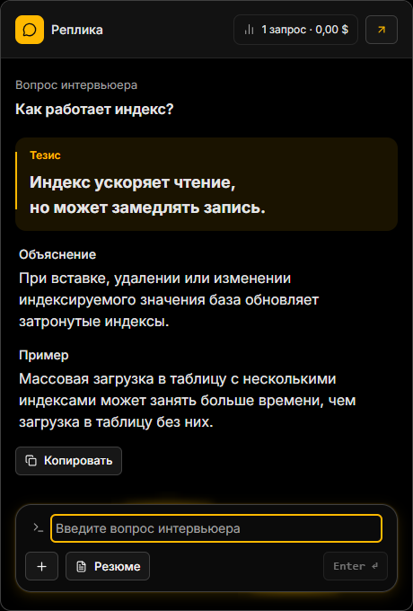
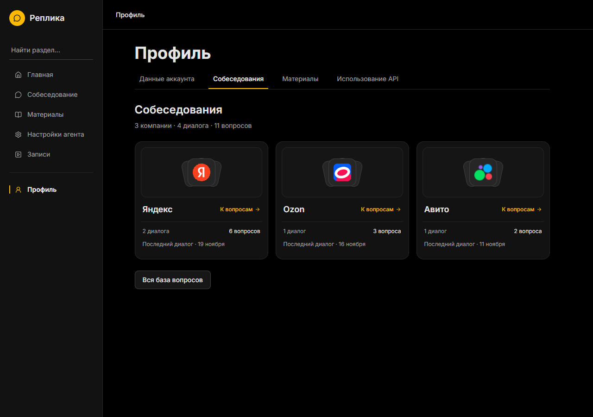
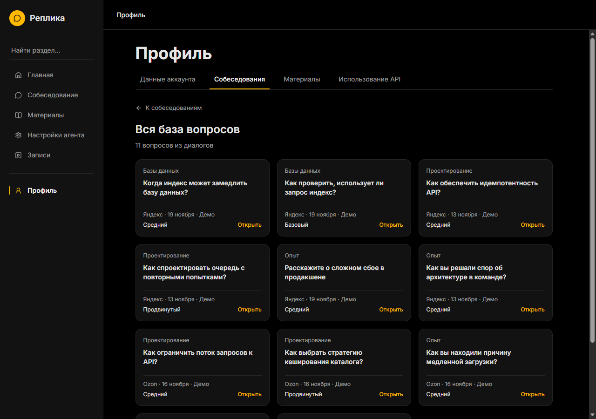
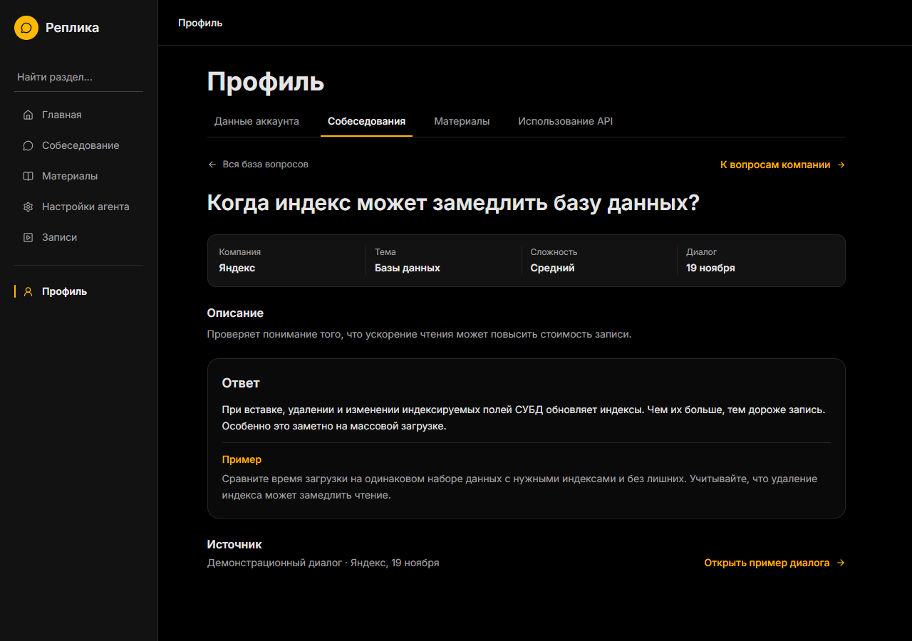
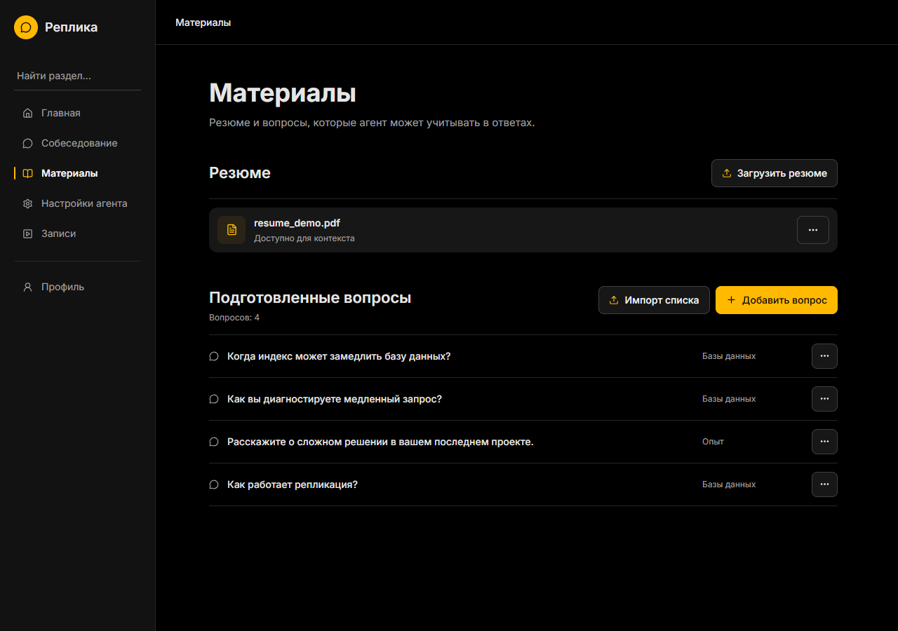
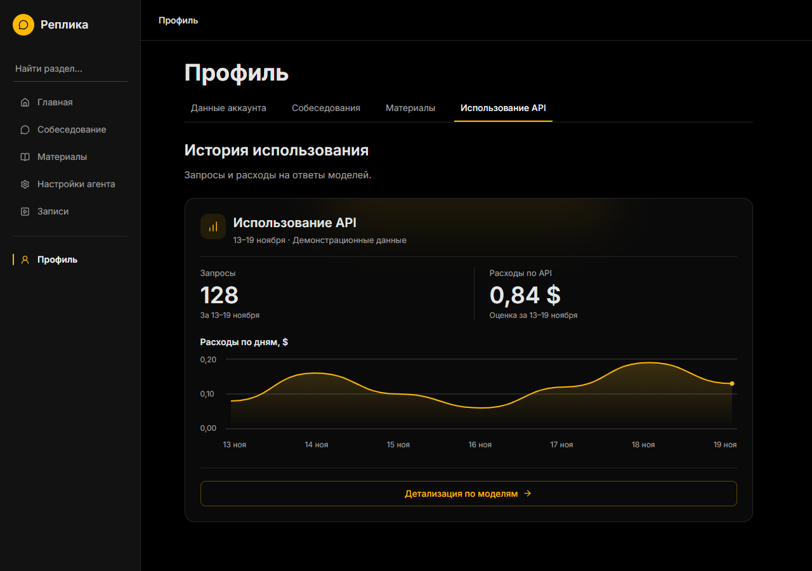

# Реплика

**v0.1.0 · Только фронтенд**

Десктопный прототип для Windows, который помогает разбирать вопросы с технических собеседований и собирать материалы для подготовки. Интерфейс написан на React и TypeScript, оформлен на Tailwind CSS и работает в оболочке Tauri 2.

## Что можно попробовать

- Выбрать модель и компанию перед началом диалога. Для своей компании можно загрузить логотип или использовать инициалы.
- Ввести вопрос и получить демонстрационный ответ с тезисом, объяснением и примером. Обычный и компактный чат показывают ожидание, ошибку и повторную отправку.
- Подготовить материалы в отдельной вкладке профиля. Она содержит резюме и список вопросов для контекста.
- Открыть карточку компании, перейти к её вопросам или посмотреть общую базу. Завершённые ответы сохраняются локально вместе с указанием исходного диалога.
- Посмотреть демонстрационную статистику использования API и экран отдельного окна регистрации.

В этой версии ответы и подключение к моделям имитирует локальный адаптер. Регистрация проверяет форму в интерфейсе. Компании, материалы и история вопросов хранятся на устройстве. Записи экрана и диалога представлены экраном-заглушкой.

## Запуск из исходников

Установите Node.js и pnpm. Для десктопного режима на Windows понадобятся Rust с инструментами MSVC и WebView2 Runtime. [Требования Tauri для Windows](https://v2.tauri.app/start/prerequisites/)

```bash
pnpm install --frozen-lockfile
pnpm dev
```

Vite выведет адрес стенда. Для запуска отдельного окна приложения выполните `pnpm tauri dev`.

В приложении откройте **«Подключить модель» → «Демо-ключ» → «Добавить»**. Затем вернитесь на главную и нажмите **«Начать собеседование»**.

`pnpm build` проверяет TypeScript и собирает фронтенд. `pnpm test` запускает тесты Vitest. После сборки команда `pnpm test:browser` проверяет сценарии в установленном Microsoft Edge.

## Скриншоты приложения

### Главная


### Выбор компании


### Чат собеседования


### Компактный чат


### Профиль и компании


### Общая база вопросов


### Карточка вопроса


### Материалы


### Использование API

